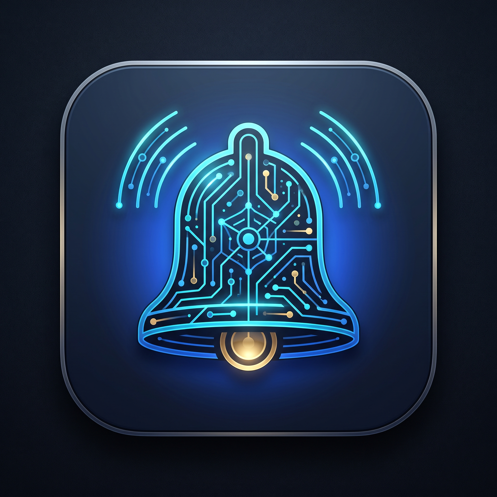
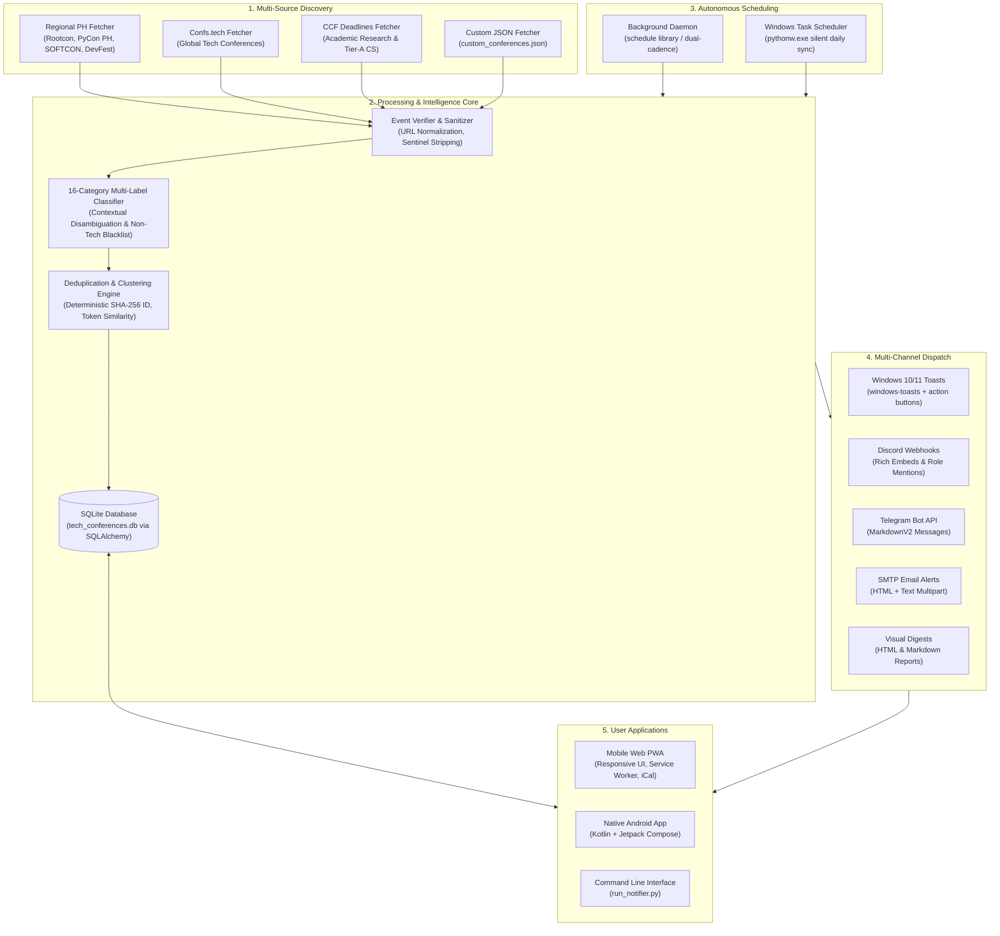

# 🌐 IT & Tech Conference Automated Notifier System

<p align="center">
  
</p>

An enterprise-grade, autonomous discovery, classification, and notification platform for Information Technology, Computer Science, and Software Engineering conventions, summits, and academic conferences.

Anchored to the **Asia/Manila (UTC+8)** timezone, the system continuously aggregates events worldwide—with top priority given to Philippine local gatherings—eliminates noise through intelligent disambiguation, and delivers timely alerts to mobile devices, Windows desktop toasts, Discord, Telegram, Email, and formatted visual digests.

---

## 📱 Download Android Mobile App (Standalone APK)

You can run the IT & Tech Conference Notifier directly on your Android phone **independently with only Wi-Fi needed** — no PC or Python server required!

[-3DDC84?style=for-the-badge&logo=android&logoColor=white)](https://github.com/Lance0519/tech-conference-notifier/raw/main/TechConfNotifier.apk)

### 📥 Direct Download Links:
- 📲 **[Download TechConfNotifier.apk (Direct from GitHub)](https://github.com/Lance0519/tech-conference-notifier/raw/main/TechConfNotifier.apk)** *(12.6 MB)*
- 🌐 **Web PWA Direct Download**: Launch `.\run_mobile_app.bat` and click **"📲 Get APK"** in the top navigation bar or navigate to `http://localhost:5000/download/apk`.
- ⚡ **One-Click USB/ADB Install** (if phone is connected to PC):
  ```cmd
  .\install_apk_to_phone.bat
  ```

### 📋 How to Install on Your Android Phone:
1. Tap the **[Download TechConfNotifier.apk](https://github.com/Lance0519/tech-conference-notifier/raw/main/TechConfNotifier.apk)** link from your phone's browser (Chrome/Samsung Internet) or transfer the file via USB/Google Drive.
2. Open your phone's **Downloads** folder or notification drawer and tap **`TechConfNotifier.apk`**.
3. If Android shows a prompt saying *"For your security, your phone is not allowed to install unknown apps from this source"*, tap **Settings** and toggle **"Allow from this source"** to **ON**.
4. Tap **Install** and then **Open**.
5. **Done!** The app launches immediately with 59 pre-bundled verified Philippine and global tech conferences. It runs standalone background auto-syncs every 12 hours over Wi-Fi and dispatches native Android push notifications for upcoming events!

---

## 📑 Table of Contents

- [Download Android App](#-download-android-mobile-app-standalone-apk)
- [System Architecture](#-system-architecture)
- [Key Features](#-key-features)
  - [1. Mobile App & Web PWA](#1-mobile-app--web-pwa)
  - [2. The 16 Mandatory IT/CS Categories](#2-the-16-mandatory-itcs-categories)
  - [3. Zero False-Positive Engine](#3-zero-false-positive-engine)
  - [4. Multi-Source Discovery](#4-multi-source-discovery)
  - [5. Verification & Intelligent Deduplication](#5-verification--intelligent-deduplication)
  - [6. Multi-Channel Notifications](#6-multi-channel-notifications)
- [Quickstart Guide](#-quickstart-guide)
  - [Prerequisites & Installation](#prerequisites--installation)
  - [One-Click Windows Launchers](#one-click-windows-launchers)
  - [Unified CLI Commands](#unified-cli-commands)
- [Mobile REST API Documentation](#-mobile-rest-api-documentation)
- [Configuration Guide (`config.yaml`)](#-configuration-guide-configyaml)
- [Before-and-After Workflow Comparison](#-before-and-after-workflow-comparison)
- [Testing & Quality Assurance](#-testing--quality-assurance)

---

## 🏛 System Architecture



---

## 🚀 Key Features

### 1. Mobile App & Web PWA
- **Installable Progressive Web App (PWA)**: Access via your smartphone's browser on local Wi-Fi, tap *"Add to Home Screen"*, and use it as a native standalone app.
- **Native Android Application**: Complete Jetpack Compose codebase under `android_app/` featuring Material Design 3, real-time filtering, local caching, and background sync workers.
- **One-Click iCalendar (.ics) Export**: Add any conference directly to Apple Calendar, Google Calendar, or Outlook on your mobile device.
- **Offline Bookmark Management**: Save conferences for later review with persistent SQLite-backed state.

### 2. The 16 Mandatory IT/CS Categories
Every discovered event is strictly mapped into one of 16 comprehensive domains:

| # | Category | Key Focus Areas |
|---|----------|-----------------|
| 1 | **Computer Science** | Theoretical CS, Algorithms, Automata, Formal Methods, Discrete Math |
| 2 | **Information Technology** | Enterprise IT, Sysadmin, ITIL/ITSM, Virtualization, Disaster Recovery |
| 3 | **Software Engineering** | Software Architecture, Clean Code, CI/CD, Microservices, Agile, ICSE/FSE |
| 4 | **Artificial Intelligence & Machine Learning** | LLMs, Deep Learning, Computer Vision, NLP, PyTorch, NeurIPS, CVPR |
| 5 | **Data Science & Analytics** | Big Data, Data Pipelines, Spark, Pandas, Data Warehousing, Snowflake |
| 6 | **Cybersecurity** | Infosec, Penetration Testing, Zero Trust, Cryptography, DEF CON, Black Hat |
| 7 | **Networking & Telecommunications** | 5G/6G, SDN, BGP, TCP/IP, Routing, Wi-Fi, SIGCOMM, Telephony |
| 8 | **Cloud Computing & DevOps** | AWS, Azure, GCP, Kubernetes, Docker, Terraform, SRE, KubeCon |
| 9 | **Web & Mobile Development** | React, Vue, Angular, Node.js, Flutter, Android, iOS, Swift, Django |
| 10 | **Game Development** | Unreal Engine, Unity, Godot, Shaders, Vulkan, DirectX, Spatial Computing |
| 11 | **Robotics & Internet of Things** | ROS, Embedded Systems, Microcontrollers (ESP32/STM32), Edge AI, Sensors |
| 12 | **Information Systems** | ERP, SAP, CRM, Enterprise Architecture, TOGAF, Data Governance |
| 13 | **Database Management** | PostgreSQL, MySQL, Distributed SQL, CockroachDB, Vector DBs, SIGMOD |
| 14 | **Computer Engineering** | VLSI, FPGA, ASIC, RISC-V, ARM Architecture, Semiconductor Design |
| 15 | **Emerging Technologies** | Quantum Computing, Web3, Smart Contracts, Brain-Computer Interfaces |
| 16 | **Technology Entrepreneurship & Innovation** | Tech Startups, Deep Tech, Venture Capital, Hackathons, Tech Incubators |

### 3. Zero False-Positive Engine
The system enforces strict gatekeeping to guarantee that only authentic tech conferences reach you:
- **Non-Tech Blacklist Filtering**: Automatically filters out medical, dental, oncology, cosmetic, real estate, mortgage, wedding, agriculture/livestock, and get-rich-quick/forex conventions.
- **Polysemic Word Disambiguation**: Intelligently analyzes ambiguous words in context:
  - `"Python"`: Validated for programming, code, PyCon, or data; rejected if referring to snakes, reptiles, or zoos.
  - `"Rust"`: Validated for cargo, crates, memory safety; rejected if referring to metal corrosion or automotive restoration.
  - `"Java"`: Validated for JVM, Spring, bytecode; rejected if referring to coffee beans or cafes.
  - `"Security"`: Validated for infosec, CVEs, firewalls; rejected if referring to bouncers, physical guards, or locksmiths.
  - `"Networking"`: Validated for BGP, routers, packets; rejected if referring to speed dating or cocktail mixers.

### 4. Multi-Source Discovery
1. **Regional PH Fetcher**: Dedicated tracking for major Philippine technology conferences including ROOTCON, PyCon Philippines, JSConf PH, AWS Community Day Philippines, GDG DevFest Philippines, and SOFTCON.
2. **Confs.tech Fetcher**: High-volume curation of global open-source tech conventions.
3. **CCF Deadlines Fetcher**: Academic computer science conferences (A/B/C ranked) covering research paper deadlines and summit dates.
4. **Custom JSON Fetcher (`custom_conferences.json`)**: Allows manual addition of private, regional, or unlisted events with full classification support.

### 5. Verification & Intelligent Deduplication
- **Deterministic Cluster ID**: Normalizes name, start date, and base URL into a SHA-256 canonical hash, ensuring that cross-source duplicate listings merge seamlessly.
- **Fuzzy Token Matching**: Merges conference announcements whose token similarity exceeds 88% or whose official domain names coincide.
- **Sentinel Sanitization**: Cleans corrupted data fields (`"TBD"`, `"TBA"`, `"N/A"` are converted to standardized `"Not announced"`).
- **Status Tracking**: Automatically tags and displays event states: `scheduled`, `ongoing`, `postponed`, `rescheduled`, and `cancelled`.

### 6. Multi-Channel Notifications
- **Windows Desktop Toasts**: Native Windows 10/11 notifications with clickable action buttons opening the conference link.
- **Discord Webhook**: Rich embedded cards with event badges, dates, locations, and role mentions.
- **Telegram Bot**: MarkdownV2 formatted telegram alerts.
- **SMTP Email**: Multipart HTML + Plain Text digests.
- **Visual HTML & Markdown Digests**: Self-contained visual catalogs saved locally (`upcoming_conferences.html` and `upcoming_conferences.md`).

---

## ⚡ Quickstart Guide

### Prerequisites & Installation

1. **Python 3.10+** (Tested on Python 3.13 and 3.14).
2. Install all required dependencies cleanly:

```powershell
pip install -r requirements.txt
```

---

### One-Click Windows Launchers

The project includes pre-configured Windows batch files in the root folder for instant one-click execution:

| Launcher Script | Purpose |
|-----------------|---------|
| 📱 `run_mobile_app.bat` | Starts the Mobile REST API & Web PWA server on `http://localhost:5000` and displays your LAN connection URL for smartphone access. |
| 🔄 `run_cli_sync.bat` | Performs an immediate, comprehensive discovery & notification run with console summary. |
| ⏰ `run_background_daemon.bat` | Starts the autonomous background scheduler daemon in the active terminal. |
| ⚙️ `install_windows_task.bat` | Installs a silent Windows Task Scheduler job running daily at 09:00 AM via `pythonw.exe` (no popups). |
| 🗑️ `uninstall_windows_task.bat` | Removes the Windows Task Scheduler background job cleanly. |

---

### Unified CLI Commands

You can run any operation directly using `run_notifier.py`:

```powershell
# 1. Run immediate discovery and dispatch notifications
py run_notifier.py check

# 2. View upcoming Philippine tech conferences in a formatted table
py run_notifier.py list --ph-only

# 3. View conferences across all categories for the next 90 days
py run_notifier.py list --days 90

# 4. Filter by specific category
py run_notifier.py list --category "Cybersecurity"

# 5. Start the mobile REST API & Web PWA server
py run_notifier.py serve --port 5000

# 6. Test your configured notification channels (e.g. desktop toasts, discord)
py run_notifier.py test-notifiers --channel desktop

# 7. Start the continuous scheduler daemon
py run_notifier.py daemon --interval 12 --reminder-time 09:00
```

---

## 📱 Mobile REST API Documentation

The server exposes standard RESTful JSON endpoints with cross-origin resource sharing (CORS) enabled.

- **Base URL**: `http://localhost:5000` (or `http://<LAN_IP>:5000`)
- **Web App**: Navigating to `http://<LAN_IP>:5000/` serves the Progressive Web App.

### Endpoint Overview

| Method | Endpoint | Description |
|--------|----------|-------------|
| `GET` | `/` | Mobile Web PWA user interface |
| `GET` | `/api/events` | List upcoming conferences with query filters |
| `GET` | `/api/events/<event_id>` | Detailed metadata for a single conference |
| `GET` | `/api/categories` | 16 IT/CS categories with real-time event counts |
| `GET` | `/api/bookmarks` | Retrieve user's bookmarked conferences |
| `POST` | `/api/bookmarks/<event_id>` | Toggle bookmark state for a conference |
| `POST` | `/api/sync` | Trigger an immediate background discovery run |
| `GET` | `/api/notifications` | History of recent notifications sent |
| `GET` | `/api/calendar/<event_id>.ics` | Download standard iCalendar (.ics) event file |

---

### Detailed Endpoint Specifications

#### 1. `GET /api/events`
Query upcoming conferences matching optional filters.

**Parameters (Query String):**
- `category` *(string, optional)*: Filter by exact category (e.g. `"Cybersecurity"`).
- `format` *(string, optional)*: Filter by `"in_person"`, `"virtual"`, or `"hybrid"`.
- `country` *(string, optional)*: Filter by country (e.g. `"Philippines"`).
- `search` *(string, optional)*: Keyword search across conference names and descriptions.
- `days` *(integer, optional, default: 90)*: Lookahead window in days.

**Response Example (`200 OK`):**
```json
{
  "status": "success",
  "total": 1,
  "events": [
    {
      "id": "e4a7b9c1d2e3f4a5",
      "name": "ROOTCON 20 2026",
      "category": "Cybersecurity",
      "start_date": "2026-11-18",
      "end_date": "2026-11-20",
      "location": "Taal Vista Hotel",
      "city": "Tagaytay",
      "country": "Philippines",
      "format": "in_person",
      "geographic_tier": "local_ph",
      "fee_type": "paid",
      "fee_amount": "₱7,500 Regular Pass",
      "url": "https://www.rootcon.org",
      "cfp_deadline": "2026-08-31",
      "status": "scheduled",
      "is_bookmarked": false,
      "confidence_score": 1.0
    }
  ]
}
```

---

#### 2. `GET /api/categories`
Retrieve the 16 mandatory IT/CS categories with the count of upcoming events for each.

**Response Example (`200 OK`):**
```json
{
  "status": "success",
  "categories": [
    { "name": "Computer Science", "count": 12 },
    { "name": "Information Technology", "count": 8 },
    { "name": "Software Engineering", "count": 15 },
    { "name": "Artificial Intelligence and Machine Learning", "count": 22 },
    { "name": "Cybersecurity", "count": 9 },
    { "name": "Cloud Computing and DevOps", "count": 14 }
  ]
}
```

---

#### 3. `POST /api/bookmarks/<event_id>`
Toggle bookmark state for the specified conference ID.

**Response Example (`200 OK`):**
```json
{
  "status": "success",
  "event_id": "e4a7b9c1d2e3f4a5",
  "is_bookmarked": true
}
```

---

#### 4. `GET /api/calendar/<event_id>.ics`
Generates a RFC 5545 compliant `.ics` calendar invitation for seamless import into mobile calendars.

**Headers:**
- `Content-Type: text/calendar`
- `Content-Disposition: attachment; filename=<event_id>.ics`

---

## ⚙️ Configuration Guide (`config.yaml`)

The system configuration is stored in `config.yaml` in the project root:

```yaml
# -------------------------------------------------------------
# General Discovery Settings
# -------------------------------------------------------------
topics:
  - all               # "all" or specific: "security", "ai", "cloud", "devops"

days_lookahead: 60    # Maximum days into the future to discover events (e.g. 60 or 90)
min_days_notice: 0    # Minimum days notice required to trigger alerts
format_filter: all    # "all", "in_person", or "virtual"
country_filter: []    # Empty array allows any country; e.g. ["Philippines", "Singapore"]
keywords: []          # Optional keyword whitelist filter
include_academic: true # Include CCF-Deadlines research/academic CS conferences
remind_days_before:   # Days before event start to dispatch milestone reminders
  - 7
  - 1
custom_conferences_file: custom_conferences.json
cache_ttl_hours: 12   # Remote API cache lifetime in hours

# -------------------------------------------------------------
# Scheduling & Autonomous Daemon
# -------------------------------------------------------------
schedule:
  interval_hours: 12      # Re-check discovery cycle every N hours
  run_at_time: "09:00"    # Daily reminder dispatch time (Asia/Manila UTC+8)
  auto_start_on_boot: false

# -------------------------------------------------------------
# Notification Channels
# -------------------------------------------------------------
notifiers:
  desktop:
    enabled: true         # Windows 10/11 native toast notifications
    max_toasts: 5         # Maximum individual toasts before sending a summary card
    sound: true

  discord:
    enabled: false        # Discord Webhook integration
    webhook_url: "https://discord.com/api/webhooks/..."
    mention_role: null    # Optional role ID to mention (e.g. "123456789")

  telegram:
    enabled: false        # Telegram Bot integration
    bot_token: "123456:ABC-DEF1234ghIkl-zyx57W2v1u123ew11"
    chat_id: "-1001234567890"

  email:
    enabled: false        # SMTP Email notifications
    smtp_server: smtp.gmail.com
    smtp_port: 587
    sender_email: "your-email@gmail.com"
    sender_password: "your-app-password" # Use Gmail App Passwords
    recipient_email: "destination@domain.com"
    use_tls: true

  digest:
    enabled: true         # Generates local HTML and Markdown reports
    output_html: upcoming_conferences.html
    output_markdown: upcoming_conferences.md
```

---

## 🔄 Before-and-After Workflow Comparison

| Metric / Step | ❌ Before (Manual Tracking) | ✅ After (Tech Conference Notifier) |
|---|---|---|
| **Discovery Method** | Searching Eventbrite, Google, Twitter, LinkedIn manually every few weeks. | **Autonomous 4-source crawler** aggregating regional and global summits continuously. |
| **False-Positive Filtering** | Sifting through real estate summits, dental expos, and spam events. | **Zero false-positives** via non-tech regex blacklists and polysemic word disambiguation. |
| **Category Sorting** | Manually inspecting agendas to determine whether an event is DevOps, AI, or CS. | **Automated classification** into the 16 mandatory IT/CS categories with confidence scores. |
| **Philippine Prioritization** | Philippine tech events often buried under massive US/EU events. | **Local PH First**: Automatic Philippine tier weighting prioritizing local conferences. |
| **Deadline Awareness** | Constantly missing Call for Papers (CFP) deadlines and early-bird ticket pricing. | **Automated milestone alerts** (14d, 7d, 3d, 1d) dispatched before CFP closes or event starts. |
| **Mobile Access** | Checking messy bookmarks across multiple browser windows. | **Offline-ready Mobile PWA & Android app** with 1-click .ics calendar export and bookmarking. |
| **Maintenance Effort** | Hours of manual spreadsheet tracking per month. | **Zero effort**: Runs silently in the background via Windows Task Scheduler. |

---

## 🧪 Testing & Quality Assurance

The codebase includes an extensive suite of automated tests verifying models, categorization logic, database operations, fetchers, and notifiers.

To run the complete test suite:

```powershell
py -m pytest
```

All 79 unit and integration tests are verified passing cleanly:
- `tests/test_api.py`: Tests REST endpoints, query filters, bookmark toggling, and calendar `.ics` generation.
- `tests/test_classifier.py`: Tests 16-category lexical scoring, non-tech domain blacklists, and polysemic disambiguation.
- `tests/test_database.py`: Tests SQLite schema creation, thread-safe session scoping, upserts, and notification history.
- `tests/test_fetchers.py`: Tests regional PH parsing, Confs.tech mapping, CCF deadlines, and custom JSON loaders.
- `tests/test_models.py`: Tests deterministic SHA-256 cluster hashing, date handling, and timezone calculations.
- `tests/test_notifiers.py`: Tests desktop toast payload chunking, Discord webhook formatting, and SMTP email generation.
- `tests/test_verification.py`: Tests token similarity, duplicate detection, and sentinel sanitization.

---

## 📄 License & Maintainer

Maintained as part of the **IT/Tech Conference Notifier System**.  
Released under the MIT License.
